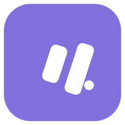
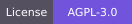
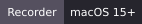
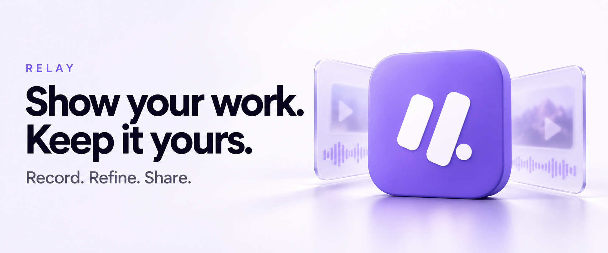

<p align="center">
  
</p>

<h1 align="center">Relay</h1>

<p align="center">
  <strong>Your screen. Your stories. Your infrastructure.</strong><br>
  An open-source alternative to Loom. Self-hosted, with a native macOS recorder.
</p>

<p align="center">
  <a href="LICENSE"></a>
  <a href="#macos-recorder"></a>
  <a href="#quick-start"></a>
</p>

<p align="center">
  <a href="#quick-start"><strong>Get started</strong></a> &nbsp;·&nbsp;
  <a href="#macos-recorder">Build the Mac app</a> &nbsp;·&nbsp;
  <a href="https://relay.ideolyst.com/#ai">AI features</a> &nbsp;·&nbsp;
  <a href="#documentation">Documentation</a> &nbsp;·&nbsp;
  <a href="#contributing">Contribute</a>
</p>

<p align="center">
  
</p>

Record a walkthrough, explain a bug, or share a team update. Relay brings capture, editing, transcripts, and collaboration into a workspace you control. Keep your originals on your own infrastructure, with private transcription and optional cloud AI.

> **Alpha:** Relay is available from source. Signed Mac downloads and Homebrew installation are not available yet. See the [roadmap](docs/ROADMAP.md).

## Features

- **Record and upload:** Capture a screen, window, region, camera, or screen with a camera bubble on macOS. Keep recoverable local originals and resume interrupted uploads. Import video and audio files through the web workspace.
- **Edit and publish:** Trim, split, reorder, and stitch clips into new revisions without overwriting originals. Add timed overlays, styled captions, canvas presets, and animated thumbnails.
- **Share and collaborate:** Manage workspace access, share protected links, leave timestamped comments, and review recordings. View engagement insights, export workspace reports, and configure workspace branding.
- **Transcribe privately:** Use Parakeet v3 on your Mac or self-hosted server. Optionally select an explicitly configured Deepgram, AssemblyAI, or OpenAI speech provider.
- **Use optional AI:** Generate titles, summaries, chapters, action items, and editable workflow documents. Create SOPs, guides, issues, agent handoffs, and meeting recap drafts; manual workflow drafts work without AI.
- **Review external delivery:** Send approved workflow content to configured destinations such as GitHub, Slack, Jira, and Notion. Gmail and Outlook integrations create drafts rather than sending email.

Recording, editing, playback, and Parakeet transcription work without a cloud AI account. See [current limitations](#current-limitations) before choosing Relay for your deployment.

## Quick start

### Prerequisites

- Git, Node.js **24+**, and **pnpm 10.15.0** (pinned in `package.json`).
- A running Docker engine with **Docker Compose 2.24.4+**.
- Start with **4 CPU cores and 8 GB RAM**, plus disk space for originals and rendered revisions. Concurrent or sustained 4K processing needs more capacity.

The first transcription startup needs network access and downloads approximately **1 GB** of pinned model assets. Allow several minutes for the models to load.

### Start the local server

```sh
git clone https://github.com/RudreshNarwal/relay-recorder.git
cd relay-recorder
pnpm startup
```

`pnpm startup` generates a private `.env` with random secrets if none exists, builds the images, and starts the web app, PostgreSQL, media worker, private transcription service, and development email. It waits for service health checks and preserves existing secrets, accounts, media, and models. You do not need to run `pnpm install` on the host for this Docker workflow.

1. Create the server-owner account when prompted in an interactive terminal. There are no default credentials. If startup ran non-interactively, run `docker compose exec web pnpm bootstrap` in a terminal.
2. Open **[http://localhost:3110](http://localhost:3110)**, sign in, and create a workspace.
3. Upload a recording or build the [macOS recorder](#macos-recorder). Other users can sign up and verify their email; local development messages appear in **[Mailpit](http://localhost:8025)**.

Use the exact origin configured in `BETTER_AUTH_URL` in both the browser and Mac app. Startup launches the server stack; the native recorder opens separately.

### Stop and restart

```sh
docker compose -f compose.yaml --profile dev stop
```

Run `pnpm startup` again to rebuild and restart. Docker volumes `postgres`, `media`, and `models` persist database records, recordings, and cached model weights. **Do not use `docker compose down -v` on an instance whose data you want to keep.** Back up the database, media, and `.env`, including its encryption key; see the [backup and restore guide](docs/DEPLOYMENT.md#consistent-backup).

### Production hosting

The quick start binds the web app to loopback and uses development email. For public hosting, follow the [deployment guide](docs/DEPLOYMENT.md): configure a domain, HTTPS through the included Caddy override, real SMTP or Resend delivery, persistent storage, and backups. Keep PostgreSQL and the transcription service private. Production uses `compose.production.yaml`; `pnpm startup` always uses the local configuration.

## macOS recorder

Requires **macOS 15+**, **Apple Silicon**, **Swift 6.2+**, and the macOS SDK. Xcode is recommended; compatible standalone Command Line Tools can also build the package.

From the repository root:

```sh
pnpm package:mac
open apps/macos/dist/Relay.app
```

Packaging creates the app and DMG, then copies the DMG into the web application's downloads directory. Rebuild the web image after packaging to enable the **Get the Mac app** link. For the local stack, `pnpm startup` performs that rebuild.

In the app's Settings, enter your server origin, sign in through the browser, and select a workspace. Grant Screen Recording, Microphone, and Camera permissions as needed. Recording also works offline without signing in; local originals remain available after upload.

Local builds are ad-hoc signed. Trusted public distribution requires your Developer ID signing identity and notarization credentials. See the [Mac documentation](apps/macos/README.md) for packaging, permissions, shortcuts, recovery, and local model management.

## Transcription and optional AI

Parakeet v3 is the default transcription system and supports its documented 25-language set. The Mac's **Auto** mode chooses a verified, runnable local model when available, otherwise private server transcription. **Local-only** never switches providers. Browser imports default to private server Parakeet.

Server owners can configure and test Deepgram, AssemblyAI, or OpenAI speech settings and allow specific workspaces to use them. Selecting an external provider sends audio to that provider and may incur charges. Relay does not silently switch providers after a failure. Captions and word-based cuts depend on the timing information returned by the selected model; untimed transcripts remain searchable and editable. See [transcription and cleanup](docs/TRANSCRIPTION.md).

For AI document generation, open **Settings → AI providers** as the server owner. Choose Gemini AI Studio, Vertex AI, OpenAI, Anthropic, or OpenRouter, configure credentials and a model, then test the connection. Vertex uses server-side Application Default Credentials. Cloud AI operates on transcripts; provider usage may incur charges. See [provider configuration](docs/DEPLOYMENT.md#provider-credentials).

## Development

### Run the web app and worker on the host

Use the same Node.js and pnpm versions as the quick start. Install FFmpeg and ffprobe on the host for media processing. Start from a fresh checkout, or stop the local Compose stack before switching to this workflow.

```sh
pnpm install --frozen-lockfile
pnpm setup
docker compose -f compose.yaml --profile dev up -d --wait db mail
pnpm migrate
pnpm bootstrap
pnpm dev
```

Run the worker in another terminal from the repository root:

```sh
pnpm worker
```

For private transcription, run the [ASR service](services/asr/README.md) on loopback port **8100** with the same `INTERNAL_API_TOKEN` as the web app and worker. Its host setup requires Python 3.11+ and the dependencies in its requirements file.

`pnpm setup` preserves an existing `.env`; check its values when switching environments. Host development defaults to `DATA_DIR=./data`, while Compose stores media in a separate Docker volume. Web and worker must use the same database and media storage. **Do not run host and container workers against the same database with different storage roots.**

`pnpm dev` starts only the web development server at `http://localhost:3110`. `pnpm build` builds the web app; `pnpm start` runs the built web server only. See [`.env.example`](.env.example) for available environment settings.

### Checks

After installing dependencies, run from the repository root:

```sh
pnpm test
pnpm typecheck
pnpm build
```

Some tests require FFmpeg/ffprobe. Database and live-service tests have environment gates, so a default test run can skip those checks.

For the API suite, use a local development PostgreSQL server and `.env`:

```sh
node --env-file=.env --import tsx --test tests/api.test.ts
```

**The API suite creates and resets the dedicated `relay_api_test` database on the server selected by `DATABASE_URL`.** Its database role needs permission to create that database. Worker integration tests require a separately migrated, disposable database in `TEST_DATABASE_URL`. Never use a production database or server for these tests. See [worker validation](services/worker/VALIDATION.md#reproduction) for integration and live-model prerequisites.

On a Mac with the required toolchain:

```sh
swift test --package-path apps/macos
```

## Architecture

| Component | Responsibility |
| --- | --- |
| `apps/macos` | SwiftUI recorder using ScreenCaptureKit and AVFoundation, Keychain authentication, recoverable local recordings, and FluidAudio transcription |
| `apps/web` | Next.js and React workspace, editor, and playback UI |
| `packages/core` | Authentication, authorization, versioned API, database schema, uploads, and encrypted settings |
| `services/worker` | PostgreSQL-backed job leases, FFmpeg processing, revision rendering, captions, AI generation, and external delivery |
| `services/asr` | Private CPU Parakeet v3 transcription using ONNX and pinned model assets |

The web app and worker share PostgreSQL and media storage. The ASR service has its own model cache and remains on the private service network. The [OpenAPI contract](docs/openapi.json) is also served at `/api/openapi`.

Uploads use checksum-verified, retryable **8 MiB** parts. Recording admission defaults to **32 GiB** and **six hours**, configurable through `RELAY_MAX_UPLOAD_BYTES` and `RELAY_MAX_DURATION_SECONDS` within [documented ceilings](docs/DEPLOYMENT.md#recording-admission-limits). These limits are not performance guarantees.

Capture, upload, processing, and publication have separate states. Edits create revisions while retaining originals. Viewers receive the published revision, and media requests recheck access. Explicit server deletion schedules media removal after seven days; deleting a local recording is separate from deleting its server copy.

## Documentation

| Guide | Contents |
| --- | --- |
| [Deployment](docs/DEPLOYMENT.md) | HTTPS, email, storage, credentials, backups, restore, upgrades, and diagnostics |
| [Mac recorder](apps/macos/README.md) | Capture, permissions, local models, recovery, signing, and notarization |
| [Transcription](docs/TRANSCRIPTION.md) | Private and external speech providers, transcript capabilities, and experimental cleanup |
| [Workflows](docs/WORKFLOWS.md) | Manual and AI document drafts, agent handoffs, and meeting recaps |
| [Integrations](docs/INTEGRATIONS.md) | Reviewed external delivery, connector requirements, and recovery |
| [Presentation](docs/PRESENTATION.md) | Overlays, captions, canvas presets, and export behavior |
| [Analytics](docs/ANALYTICS.md), [Reports](docs/REPORTS.md), [Branding](docs/BRANDING.md) | Recording engagement, workspace reporting, and visual identity |
| [Meeting capabilities](docs/MEETING-CAPABILITIES.md) | Automatic capture prerequisites and remaining qualification gaps |
| [API contract](docs/openapi.json) | Machine-readable HTTP API reference |
| [Loom comparison](docs/LOOM-COMPARISON.md) | Current AI capabilities, premium-feature gaps, and evidence |
| [Website](website/README.md) | Marketing site preview, checks, and Cloudflare deployment |
| [Validation](docs/VALIDATION.md) | Recorded validation evidence and remaining hardware checks |

## Current limitations

- **Platform coverage:** The native recorder targets Apple Silicon Macs. Windows, mobile, and Chrome recording clients are not available.
- **Meeting automation:** Calendar sync and per-occurrence selection do not provide automatic recording. Autonomous Zoom, Google Meet, and Teams capture is not available. Uploaded or attended recordings can opt into recap drafts after transcription.
- **Cleanup quality:** Silence and filler cleanup is experimental. Review proposals before applying them; language-specific quality benchmarks remain incomplete.
- **Provider qualification:** External speech and delivery adapters have fixture-based tests, but live-account qualification remains pending. Parakeet's documented languages do not imply measured accuracy for every language.
- **Capacity and hardware:** Long-duration transcription, sustained 4K workloads, and physical capture behavior still need qualification on your hardware.
- **Enterprise features:** SSO/SCIM and custom media retention are not implemented. Billing and voice synthesis are outside the current scope.

## Contributing

Bug reports, documentation improvements, and focused pull requests are welcome through [GitHub Issues](https://github.com/RudreshNarwal/relay-recorder/issues) and [pull requests](https://github.com/RudreshNarwal/relay-recorder/pulls).

Read [CONTRIBUTING.md](CONTRIBUTING.md) for setup, review expectations, and ways to help. Start with a [good first issue](https://github.com/RudreshNarwal/relay-recorder/issues?q=is%3Aissue%20is%3Aopen%20label%3A%22good%20first%20issue%22), or ask a question in [Discussions](https://github.com/RudreshNarwal/relay-recorder/discussions). Participation follows the [Code of Conduct](CODE_OF_CONDUCT.md); report vulnerabilities through [SECURITY.md](SECURITY.md).

1. For a substantial change, open an issue describing the problem and proposed approach first.
2. Fork the repository, create a branch, and follow the [development setup](#development).
3. Keep changes focused, add regression coverage for behavior changes, and update affected documentation.
4. Run the relevant checks and describe the change, verification results, and any skipped checks in your pull request.

Include reproduction steps and relevant platform versions with bug reports. Remove credentials, private recording content, and personal data from logs or attachments before posting.

The current core is AGPL-3.0-only licensed. Optional paid hosting, setup, and support may fund maintenance; no subscription is required to self-host.

## License

Relay's original code is licensed under the [GNU Affero General Public License, version 3 only](LICENSE) (`AGPL-3.0-only`). You may use, modify, and redistribute it under those terms, including for commercial purposes. It comes without warranty.

If you modify Relay and let users interact with that version over a network, AGPL requires an offer of its corresponding source to those users. Distribution also carries source and license obligations. See the license for the full terms; third-party components retain their own licenses.

Third-party dependencies, model weights, and assets retain their own licenses and terms; the project license does not relicense them. See [third-party notices](THIRD_PARTY_NOTICES.md), the [bundled audio model provenance](services/worker/models/README.md) and the respective upstream projects for their terms.
